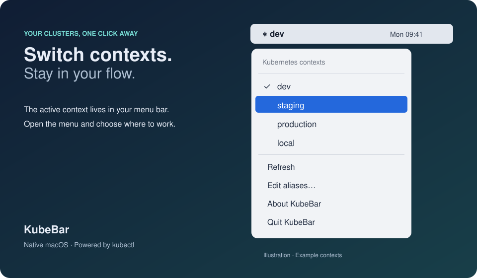
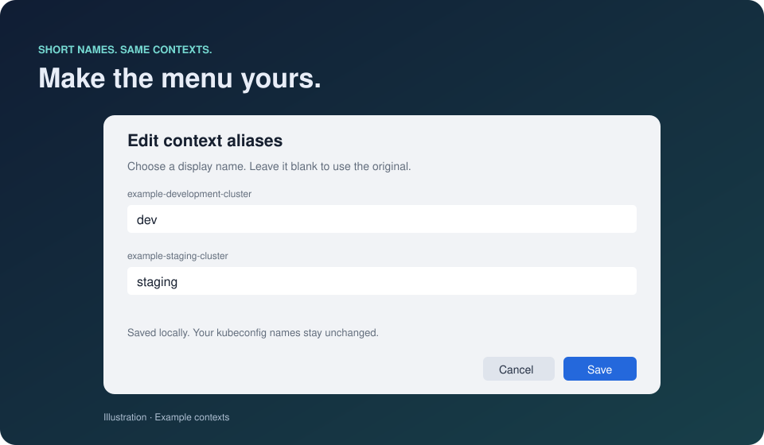

# KubeBar

A tiny native macOS menu bar utility for switching Kubernetes contexts. No Electron, dependencies, or cluster access required; it uses your installed `kubectl` to read and update local configuration.



*Illustrated preview using example contexts.*

## Build and run

Requires macOS 12+ and Xcode Command Line Tools (`xcode-select --install`). Install `kubectl` separately if needed.

```sh
./scripts/build.sh
open build/KubeBar.app
```

Click the context name in the menu bar, then select a context. The active context has a checkmark. Changes from a terminal appear within 15 seconds, or when opening the menu. Configured display aliases appear in both the bar and menu; hover to see the full context name. Unknown contexts retain their original names (shortened in the bar if needed). Aliases only change the display and never rename kubeconfig entries.

No personal context mappings are bundled with the app. Set display aliases through **Edit aliases…**; they are stored only in your local macOS preferences, outside the project.

You can move `build/KubeBar.app` to Applications. To start at login, add the app under System Settings → General → Login Items.

## Configuration

KubeBar finds `kubectl` on its inherited PATH or in `/opt/homebrew/bin`, `/usr/local/bin`, and `/usr/bin`. It uses `~/.kube/config` by default. Finder-launched apps do not inherit your terminal shell configuration. To use a custom configuration, quit KubeBar and launch its executable directly:

```sh
KUBECONFIG="$HOME/.kube/work-config" ./build/KubeBar.app/Contents/MacOS/KubeBar
```

Switching runs `kubectl config use-context NAME` and changes the context for all commands sharing that kubeconfig. It does not contact clusters or modify workloads. Configuration errors appear under “View error…” in the menu. No configuration contents are logged.

The build is locally ad-hoc signed, not notarized for distribution. Rebuild on the Mac where you intend to use it.

## Editing aliases



*Illustrated preview. Aliases are saved locally on your Mac.*

Choose **Edit aliases…** in the KubeBar menu. Change any display names and click **Save** to apply them immediately. **Cancel** discards edits. Leave a field blank to display the original context name. Aliases persist across restarts in KubeBar’s macOS preferences; kubeconfig entries are never renamed. Hover over a context label to see its full name.
